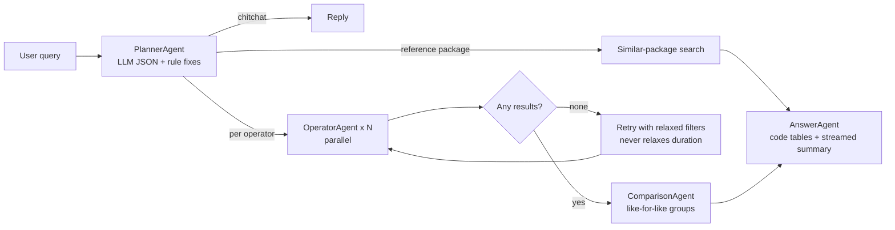

# Telecom Package Assistant

A chat assistant that compares **Pakistani prepaid mobile packages** from
**Jazz, Zong and Ufone**. It runs on scraped package data, a multi-agent
pipeline orchestrated with **LangGraph**, a local LLM served by **Ollama**,
and a **Streamlit** interface.

<!-- Add a screenshot: save it as docs/screenshot.png -->
<!--  -->

> **Disclaimer:** This is an independent project and is not affiliated with
> Jazz, Zong or Ufone. Package data is scraped from public pages and may be
> outdated or contain parsing errors. Always verify prices and terms with the
> operator before buying.

---

## Features

- **Natural-language queries**: "compare weekly packages of zong jazz and
  ufone by onnet minutes", "weekly packages under Rs 300", and so on.
- **Strict duration filtering**: "30 days" returns only 30-day packages, never
  weekly, daily or 6-month ones. If an operator has no package of that
  duration, the assistant says so and lists the durations that do exist.
- **Rank by any resource**: price, data, on-net minutes, total minutes, SMS,
  price per GB, price per day, price per 100 on-net minutes.
- **Like-for-like comparison**: packages are grouped by profile (combo, voice,
  social, data, SMS) and duration, so a social-media bundle is never compared
  against a general data package.
- **Reference packages**: "compare my5 with its competitors in ufone and jazz"
  finds the named package and the closest equivalents at other operators.
  Ambiguous or unknown names produce a clarifying message instead of a guess.
- **Follow-ups**: "now also provide for ufone" keeps the previous scope.
- **Typo tolerant**: "ufine", "zog" and similar are understood.
- **Reliable numbers**: tables are built in code, not by the LLM. The LLM only
  writes the short summary.
- **Streaming UI**: progress status, then the table, then the summary
  as it is generated.

## How it works



| Component | Role |
|---|---|
| `PlannerAgent` | Asks the LLM for a JSON plan, then overrides it with deterministic rules for operators, duration, price, sort key, package names and follow-ups. |
| `OperatorAgent` | One per operator. Applies the strict duration filter, then other filters, then sorts by the requested resource. |
| `ComparisonAgent` | Builds like-for-like groups across operators and computes winners. |
| `AnswerAgent` | Renders tables in code and streams a short LLM summary. |
| `Orchestrator` | LangGraph state graph: plan, fan-out to operators, check, optional retry, compare. Keeps session memory for follow-ups. |

The agents were first built as plain Python classes. LangGraph only handles
orchestration (routing, parallel fan-out, retry), so it does not change the
accuracy of the results.

## Project structure

```
.
├── app.py              Streamlit UI
├── agents.py           Planner, Operator, Comparison and Answer agents
├── orchestrator.py     LangGraph graph and streaming API
├── schemas.py          Pydantic models (Plan, SortKey)
├── llm.py              Ollama client (JSON mode, streaming, error handling)
├── tools.py            Filtering and sorting helpers
├── data_loader.py      Loads and cleans the Excel files
├── formatting.py       Markdown table formatting
├── config.py           Model name, host, paths and settings
├── timing.py           Latency measurement script
├── jazz_scraper.py     Jazz scraper
├── zong_scraper.py     Zong scraper
├── ufone_scraper.py    Ufone scraper
├── data/               Excel files (see "Get the data")
└── .streamlit/         Theme configuration
```

## Requirements

- Python 3.9 or newer
- [Ollama](https://ollama.com) installed and running
- A pulled model (see [Choosing a model](#choosing-a-model))
- For the browser-based scraper mode: Playwright and Chromium

## Installation

```bash
git clone https://github.com/<your-username>/telecom-package-assistant.git
cd telecom-package-assistant

python -m venv .venv
# Windows
.venv\Scripts\activate
# macOS / Linux
source .venv/bin/activate

pip install -r requirements.txt
```

Optional, only if you use the scrapers' `--browser` mode:

```bash
playwright install chromium
```

Pull a model and set it in `config.py`:

```bash
ollama pull qwen3.5:9b
```

## Get the data

The app expects three files in `data/`:

```
data/jazz_packages.xlsx
data/zong_packages.xlsx
data/ufone_packages.xlsx
```

Generate them with the scrapers:

```bash
python jazz_scraper.py  --out data/jazz_packages.xlsx
python ufone_scraper.py --out data/ufone_packages.xlsx
python zong_scraper.py
```

Useful scraper options (Jazz and Ufone): `--browser`, `--save-html`,
`--load-html`, `--discover`, `--include-broadband`, `--no-verify`,
`--extra-url`, `--delay`. Run each script with `--help` for the full list.

The scrapers collect **prepaid** packages only. Postpaid, regional,
international and broadband packages are excluded by default.

Each workbook has sheets for packages, excluded items, a scrape log and
notes. Rows highlighted **yellow** could not be read or verified. Rows
highlighted **orange** have a mismatch between the listing page and the
package page.

Please be polite to the operators' servers: keep the default delay and check
each site's terms of use. The scrapers are intended for personal and
educational use.

## Run

```bash
streamlit run app.py
```

Then open the URL shown in the terminal (usually http://localhost:8501).

### Example queries

| Query | What you get |
|---|---|
| `compare weekly packages of zong jazz and ufone by onnet minutes` | Like-for-like weekly packages ranked by on-net minutes. |
| `compare 3 days packages of zong jazz and ufone` | 3-day packages only. Operators without one say so and list their real durations. |
| `now also provide for ufone` | Follow-up that keeps the previous scope and adds Ufone. |
| `compare monthly packages of zong with jazz` | 28-31 day packages grouped by type. |
| `compare my5 with its competitors in ufone and jazz` | Zong My5 as the reference, with the closest Jazz and Ufone equivalents. |
| `weekly packages under Rs 300` | Weekly packages within budget. |

## Choosing a model

Speed and accuracy depend almost entirely on the local LLM, not on the agent
code. Observed on a CPU-only laptop (12 GB RAM, no dedicated GPU):

| Model | Behaviour |
|---|---|
| `qwen3.5:9b`, thinking on | Very slow. A one-word reply took over a minute because the model reasons silently first. |
| `qwen3.5:9b`, thinking off | Accurate, but about 3 tokens/s on CPU, so answers take a while. |
| `qwen3.5:0.8b` | Fast, but gave wrong answers. Not recommended for the summary step. |

Tips:

- Turn thinking **off** for Qwen3-family models.
- Keep the model loaded between requests (`keep_alive`) so Ollama doesn't
  reload it after 5 idle minutes.
- A GPU makes a large difference. Integrated graphics (for example Intel UHD)
  are not used by Ollama in most setups.
- Run `python timing.py` to see how long the planner, table and answer take.

## Known limitations

- **Scraped data can be wrong.** Examples seen so far: some on-net and SMS
  values are misparsed on certain Ufone and Zong pages, and Ufone tax is
  not captured. Check `Scrape Log` and the highlighted rows in the Excel files.
- **Jazz coverage is smaller** than the other operators and may need
  `--browser` mode to scrape fully.
- **Scrapers depend on page layouts.** If an operator redesigns its site, the
  corresponding scraper needs an update.
- **Small LLMs make mistakes** when writing the summary. The tables are always
  correct relative to the data, but the summary text is only as good as the
  model.
- The UI uses CSS selectors that can change between Streamlit versions.

## Roadmap

- Write the key comparison facts in code and use the LLM only for a one-line
  recommendation, so small models can be used safely.
- Separate, smaller model for the planner.
- Skip the LLM planner when the rules already cover the query.
- Automated tests for the planner rules and duration filter.
- Scheduled scraping and a data-freshness indicator in the UI.

## Contributing

Issues and pull requests are welcome. For a data problem, include the
operator, the package name, the value you expected and the value the app
showed. For a bad answer, include the query and the plan JSON from the
"How I understood your question" panel.
